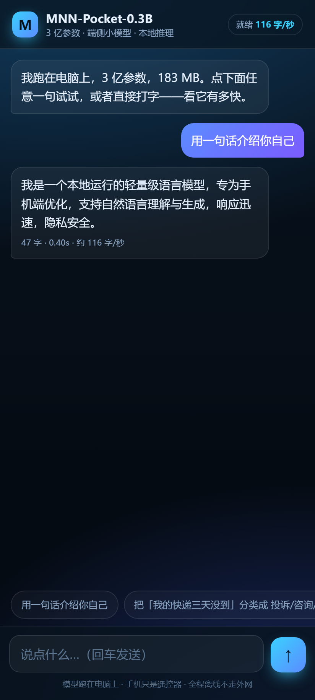

<div align="center">

# 🐋 3 亿参数，183 MB，483 tokens/s

### 我把阿里 MNN-Pocket-0.3B 扒光了测：291 次调用、4 轮压测、4 档横评

**结论只有一句话：它是一双极快的手，不是一个会思考的脑。**

<br>


<br>


<br>


<br>

[**🚀 快速结论**](#-三十秒看懂) · [**📊 横评榜单**](#-模型能力排名) · [**🔬 工程实录**](#-工程实录) · [**💀 翻车现场**](#-翻车现场精选) · [**📁 原始数据**](#-原始数据)

</div>

---

## 🎯 三十秒看懂

<table>
<tr><td width="50%">

### ✅ 它真的行

- **483 tok/s** 解码速度，4 并发干到 **1066 tok/s**
- 抽 JSON、填字段：**3/3，零失误**
- 写代码骨架（递归/边界/去重）：**稳**
- 算术应用题：**3/3，连折扣券都算对**
- 拒答违法请求：**6/6**
- 183 MB，手机跑得动

</td><td width="50%">

### ❌ 它真的不行

- 逻辑推理：**0/4**（三段论、数列、时间全错）
- 常识问答：**1/3**（"最大省份"答"北京"）
- 多分类意图：**3/10**
- 任何 yes/no 判断：**一律答"是"**
- 长上下文：**实际只到 2~4K**（标称 32K）
- 编造事实：**会连续编三个人名还自我否定**

</td></tr>
</table>

> **一句话：给它明确的格式和明确的任务，它又快又准；要它判断，它会用"选第一个"糊弄你，而且糊弄得很自信。**

---

## 🏆 模型能力排名

四档同题同判，26 道题，统一 `temperature=0`，统一 llama.cpp 引擎。

| 排名 | 模型 | 体积 | 得分 | 偏差失败 | 速度 | 性价比 |
|:---:|---|---:|:---:|:---:|---:|---:|
| 🥇 | **Qwen2.5-7B-Q4** | 4466 MB | **24/26** | 0/4 | 🐢 23 t/s | 0.41 分/GB |
| 🥈 | **Qwen2.5-1.5B-Q4** | 940 MB | **21/26** | 2/4 | 165 t/s | 1.34 分/GB |
| 🥉 | **MNN-Pocket-0.3B-Q4** | **183 MB** | 15/26 | **1/4** | 🚀 **467 t/s** | **3.15 分/GB** 🏆 |
| 4 | Qwen3-0.6B-Q8 | 610 MB | 13/26 | 3/4 | 239 t/s | 0.82 分/GB |

<div align="center">

### ⚡ 能力跳变发生在 1.5B，不在 0.6B

```
0.3B  ──→  0.6B   ：  15 → 13   （几乎没变，甚至更差）
0.6B  ──→  1.5B   ：  13 → 21   （★ 质变点，+8 分）
1.5B  ──→  7B     ：  21 → 24   （小幅提升）
```

</div>

### 分项战绩

| 类别 | 0.3B | 0.6B | 1.5B | 7B |
|---|:---:|:---:|:---:|:---:|
| **首选项偏差**（越高越好） | 3/4 | ❌ 1/4 | 2/4 | ✅ **4/4** |
| 分类 | 3/6 | 3/6 | 5/6 | ✅ **6/6** |
| 抽取 | 3/3 | 3/3 | 3/3 | 3/3 |
| 数学 | ✅ **3/3** | 3/3 | 2/3 | 2/3 |
| 逻辑 | ❌ 0/4 | ❌ 0/4 | 3/4 | ✅ **3/4** |
| 常识 | ❌ 1/3 | ❌ 1/3 | ✅ **3/3** | ✅ **3/3** |
| 代码 | 1/2 | 1/2 | ✅ **2/2** | ✅ **2/2** |
| 安全 | 1/1 | 1/1 | 1/1 | 1/1 |
| **总计** | 15/26 | 13/26 | **21/26** | **24/26** |
| **速度** | **467 t/s** | 239 t/s | 165 t/s | 23 t/s |

### 💡 三个反直觉的发现

**① 0.6B 是智商税档位** —— 体积是 0.3B 的 3.3 倍，得分反而**低 2 分**。同一道题错得一模一样。

**② 0.3B 比 0.6B 更抗偏差** —— 0.3B 错 1/4，Qwen3-0.6B 错 3/4。细看输出：0.3B 是"懒得判断"（换顺序能蒙对），0.6B 是"真的判断错"（换顺序照样错）。**前者能规避，后者连规避都不行。**

**③ 参数多不等于算术准** —— "200 打 8 折减 20"：0.3B ✅140、0.6B ✅140、1.5B ❌180、7B ❌144。**连 7B 都会翻车。**

---

## 💀 翻车现场精选

### 缺陷一：它永远选第一个选项

同一句话，只换选项顺序，答案跟着变。`temperature=0`，跑 3 次稳定复现。

| 测试句（正确答案：非广告） | 选项 `广告｜非广告` | 选项 `非广告｜广告` |
|---|---|---|
| 我喜欢吃苹果 | **广告** ❌ | **非广告** ✅ |
| 今天天气真好 | **广告** ❌ | **非广告** ✅ |

| 测试句（正确答案：负面） | 选项 `正面｜负面` | 选项 `负面｜正面` |
|---|---|---|
| 这件衣服质量太差了 | **正面** ❌ | **负面** ✅ |

**问它"是不是"，一律答"是"：**

| 问题 | 答案 |
|---|---|
| 这句话是在"广告"吗？句子：今天天气真不错 | **是** ❌ |
| 这句话是在"退款"吗？句子：你好，请问几点了 | **是** ❌ |
| 这句话是在"投诉"吗？句子：祝您生日快乐 | **是** ❌ |

换成 `0/1` 编码 → **一律答 0**。

> 🔬 **但它的 logprobs 里有微弱信号**："加微信领红包…"给 A(求助) 的概率是 **22.4%**，普通句只有 **8.4%**。
> **它内部隐约感觉到不对劲，但这点信号压不过输出格式的惯性。**

### 缺陷二：编造事实停不下来

**问：2027 年诺贝尔文学奖得主是谁？**

```
0.3B：得主是艾米莉·布罗克（Emily Blunt）—— 但实际上这个说法是错误的。
      正确的答案是：阿兰·德·罗（Alain de Botton）？—— 仍然错误。
      我们来纠正…

7B：  无法预测未来事件。 ✅
```

**它不是不知道自己在编，它是停不下来。** 1.5B 以上才修好。

### 缺陷三：它不会填 `____` 空

| 题目 | 结果 |
|---|---|
| 补全 `{"age":__,"city":"__"}` | ❌ 原样保留 `__` |
| 补全"中国的首都是____" | ❌ 原样照抄 |
| 改成"根据描述生成完整 JSON" | ✅ 完全正确 |

**永远别给它带下划线空格的模板，要它从头生成。**

### 缺陷四：长上下文标称 32K，实际只有 2~4K

| 上下文长度 | 能否找回暗号 |
|---|---|
| 565 tok | ✅ |
| 2163 tok | 🟡 不稳定 |
| 4288 tok | ❌ |
| 8538 tok | ❌ 完全丢失 |

> ⚠️ **还有个中文陷阱**：用"暗号"这个词问它会跑去解释词义，跟长度无关（29 tok 时对，104 tok 就开始解释）。
> 换成"代号""字符串"就正常。**中文提问别用可能被理解成"解释这个词"的名词。**

---

## 🔬 工程实录

### 起因

看到一篇公众号文章说阿里 MNN 团队开源了个 3 亿参数的端侧模型，量化后 173MB，能在 iPhone 18 Pro 上跑 350 tok/s。

**"本地 AI 真要进入手机日常应用了？"** —— 我把它的论文、源码、模型全扒了一遍。

### 第一步：核实宣传口径

| 文章说 | 实际核实 | 社区传说 |
|---|---|---|
| 11 月 4 日开源 | 官方 README 新闻栏确认 | ✅ 真的 |
| 3 亿参数 | 28 层 / hidden 896 / 14 头 2 KV 头 | ✅ 真的 |
| 量化后 173MB | INT4 MNN 包实测 166MB | ✅ 基本吻合 |
| iPhone 18 Pro 350 tok/s | 论文：iPad Pro M5 466 tok/s | ✅ 真的 |
| 32K 上下文 | config: max_position_embeddings = 40960 | ✅ 配置是真的（实际用不到） |

**数据没吹。** 那就继续测。

### 第二步：搭环境（过程很曲折）

```
网络环境（这台机器的真实情况）：
  huggingface.co       → 直连超时
  hf-mirror.com        → 通，但只有 0.06 MB/s（下载 378MB 要近 2 小时）
  modelscope.cn        → 通，3.9 MB/s（快 65 倍）★ 最终用这个
  github.com           → 直连超时（靠系统代理 127.0.0.1:65532）
  api.github.com       → 200 OK
```

**踩过的坑：**

1. **LM Studio 的 llama-server.exe 单独跑会崩** —— 报 `0xc0000135`（缺 DLL）。
   解决：把 `vendor\win-llama-cuda12-vendor-v2` 加进 PATH，CUDA 运行时才找得到。

2. **`--no-warmup` 参数不存在** —— 新版 llama.cpp 换成了 `--load-mode`。参数给错会打印一大段 usage 然后退出。

3. **跑 4.7 小时后 GPU 自己挂了** —— 日志：`CUDA error: unknown error` at `ggml_backend_cuda_synchronize`。
   笔记本休眠唤醒的典型症状。**长时间压测记得分批，别一把梭。**

4. **带中文的目录名**风险大 —— 后来全改成 ASCII，避免 adb push / 各种工具链出问题。

### 第三步：手机端部署（两条不兼容的路线）

**关键前提：MNN 格式和 GGUF 是两套东西，选错 App 等于白下。**

| 形态 | 文件 | 体积 | 只能喂给谁 |
|---|---|---|---|
| **MNN 格式** | `llm.mnn` + `llm.mnn.weight` + `tokenizer.mtok` + `llm_config.json` | 166 MB | 只有 MNN Chat |
| **GGUF** | `*-Q4_1.gguf` | 183 MB | llama.cpp 系 |

官方明确表态：**"MNN Chat is not based on llama.cpp, so cannot use gguf models"**（[issue #3902](https://github.com/alibaba/MNN/issues/3902)）

**路线 A（推荐给普通人）：PocketPal AI + GGUF**

不需要电脑、不需要 adb。手机上装 PocketPal → 导入 .gguf → 开聊。

**路线 B（官方 INT4，但绑定电脑）：**

我读了源码 `LocalModelsProvider.kt`，发现路径是**写死**的：

```kotlin
val modelsDir = File("/data/local/tmp/mnn_models/")   // 不是 sdcard！
if (modelDir.isDirectory && File(modelDir, "config.json").exists())  // 必须有 config.json
```

所以必须：

```bash
adb shell mkdir -p /data/local/tmp/mnn_models
adb push MNN-Pocket-0.3B-MNN /data/local/tmp/mnn_models/
```

**⚠️ 而且官方模型市场里根本没有这个模型** —— 我拉了 `model_market.json` 核实：prod 130 个、dev 148 个模型，**零个 Pocket 条目**。只能侧载。

### 第四步：做手机端 Web UI

因为想让主人在手机上直接看到效果，写了个零依赖的 Node 代理 + 手机聊天界面。

**踩的坑：**

- **IP 会变** —— 第一次测的 `10.35.11.158`，十分钟后路由器 DHCP 换成了 `172.28.37.182`，网络位置还从「专用」变成「公用」。
  → 改成**不写死 IP**，每次启动重新探测网卡 + 动态生成二维码页面 `/qr`。

- **PowerShell 显示中文乱码不代表数据坏了** —— `curl` 输出的 SSE 流在控制台里是乱码，但用 `[IO.File]::ReadAllText($f, UTF8)` 读就完全正常。

- **agent-browser 的 batch 命令会挂** —— 改用自己写的 CDP 驱动（Node 内置 WebSocket，零依赖），实测成功截图。

### 第五步：291 次调用，四轮压测

| 轮次 | 内容 | 调用次数 |
|---|---|---|
| 第 1 轮 | 通用能力 37 项（指令/分类/抽取/数学/常识/中文/代码/安全/鲁棒） | 37 |
| 第 2 轮 | 真实业务 24 项（QQ 分流/日志/工单/结构化） | 24 |
| 第 3 轮 | 偏差归因 + 深挖（Q4/Q8 双版本各 32 项） | 64 + 40 |
| 第 4 轮 | 上下文/吞吐/并发/真实任务（双版本） | 40 |
| 第 5 轮 | 四档横评（26 题 × 4 模型） | 104 |

### 第六步：自我纠错

**我第一版报告写错了 3 处，如实记录：**

| 项目 | 初测结论 | 复测修正 |
|---|---|---|
| 200 打 8 折 | ❌ 算成 230 | ✅ **140，3/3 全对** — 是我 max_tokens 给太少截断了 |
| 长上下文 | ❌ "超 3.3K 就丢" | 🔄 **是"暗号"触发词义解释**，跟长度无关 |
| 最大省份 | 答"内蒙古" | ❌ **复测答"北京"，更离谱** |

> **这就是为什么所有结论都要 `temperature=0` 跑 3 次。单次结果会骗人。**

---

## 📊 完整能力清单

### ✅ 放心用

| 能力 | 证据 |
|---|---|
| 结构化抽取 | JSON 输出稳定，多字段准确 |
| 日志关键词归类 | 4/5 |
| 写代码骨架 | 递归、边界、去重全对 |
| 文本改写/翻译 | 同义改写、中英互译 |
| 写短文案 | 公告、邮件主题、要点总结 |
| 简单应用题 | 折扣券计算 3/3 |
| 安全拒绝 | 越狱、违法请求基本能挡 |
| 并发服务 | 4 并发 1066 tok/s |

### 🟡 有条件用

| 能力 | 限制 |
|---|---|
| 客服工单分类 | 3/5，必须人工复核 |
| 中文长文本问答 | 别用多义名词；Q8 比 Q4 稳 |
| 英文长上下文 | 2~4K token 内 |

### ❌ 绝对别用

| 能力 | 实测表现 |
|---|---|
| 多分类意图识别 | 3/10，永远选第一个 |
| 任何 yes/no 判断 | 一律答"是" |
| 填空式提示 | 原样保留 `____` |
| 逻辑推理 | 0/4 |
| 常识事实问答 | 最大省份答"北京" |
| 长上下文 >4K | 8538 tok 全崩 |
| 拼音/成语溯源 | 全是编的 |

---

## 🛠️ 复现方式

### 环境

```
硬件  i5-14450HX / RTX 4060 Laptop 8G / 24 GB RAM
引擎  llama.cpp CUDA 2.55.0
参数  -c 16384 -ngl 99 --threads 10
```

### 下载模型

```bash
# GGUF（183MB，llama.cpp 系用）
curl -L -o MNN-Pocket-0.3B-Instruct-Q4_1.gguf \
  "https://www.modelscope.cn/api/v1/models/MNN/MNN-Pocket-0.3B-GGUF/repo?Revision=master&FilePath=MNN-Pocket-0.3B-Instruct-Q4_1.gguf"

# MNN 格式（166MB，手机 App 用）
curl -L -o llm.mnn.weight \
  "https://www.modelscope.cn/api/v1/models/MNN/MNN-Pocket-0.3B-MNN/repo?Revision=master&FilePath=llm.mnn.weight"
```

### 启动服务

```bash
llama-server \
  -m MNN-Pocket-0.3B-Instruct-Q4_1.gguf \
  --chat-template-file chat_template.jinja \
  --host 127.0.0.1 --port 8471 \
  -c 16384 -ngl 99 --threads 10
```

> ⚠️ **必须带 `--chat-template-file`**，这个模型的对话模板在模型文件里没自带，不给会输出乱格式。

### 跑测试

```bash
node scripts/stress.js      # 通用能力 37 项
node scripts/business.js    # 真实业务 24 项
node scripts/final.js       # 偏差归因（需要 Q4 + Q8 双实例）
node scripts/compare.js     # 四档横评（需要 4 个实例）
```

横向对比需要起多个实例，用环境变量指定：

```bash
MODELS='[{"name":"MNN-0.3B","port":8471},{"name":"Qwen3-0.6B","port":8474,"noThink":true}]' \
  node scripts/compare.js
```

---

## 📁 原始数据

所有结论都能在这几个 JSON 里找到对应记录，不是拍脑袋写的。

| 文件 | 内容 |
|---|---|
| [`data/stress-result.json`](data/stress-result.json) | 通用能力 37 项逐条结果 |
| [`data/business-result.json`](data/business-result.json) | 真实业务 24 项逐条结果 |
| [`data/final-result.json`](data/final-result.json) | Q4/Q8 偏差归因 + 代码/中文/逻辑/安全 深挖 |
| [`data/final2-result.json`](data/final2-result.json) | 长上下文边界 / 吞吐 / 并发 / 真实任务 |
| [`data/compare-result.json`](data/compare-result.json) | 四档模型 26 题横评 |

脚本：[`scripts/`](scripts/) — 全部零依赖，纯 Node 内置模块。

---

## 🎬 手机端效果

自建的零依赖 Web UI，手机浏览器直连电脑的推理服务：

<div align="center">

<br>
<sub>412×915 手机视口 · 真实浏览器跑通 · 0.40s 返回 · 116 字/秒</sub>
</div>

---

## 🤔 最后的思考

**"本地 AI 真要进入手机日常应用了？"**

方向是对的，但这一代 0.3B 还只是开始。

它证明了两件事：

- ✅ **端侧推理速度已经不是瓶颈** —— 3 亿参数 + INT4，笔记本 GPU 上 483 tok/s，手机端官方 350 tok/s。这个数字是硬实力。
- ❌ **3 亿参数的"理解力"还是瓶颈** —— 逻辑推理 0/4，常识 1/3，多分类 3/10。

**等 1.5B 级别的模型能做到 400MB + 300 tok/s 的那天，才是真正能日常用的节点。**

在那之前，别把它当助手。**让它当零件，它很称职。**

---

<div align="center">

### 如果这份实测对你有用，点个 ⭐

**测了 291 次调用，踩了 6 个坑，改了自己 3 个错误结论。**


<sub>测试时间 2026-11-24 · 所有数据可复现 · 欢迎提 issue 打脸</sub>

</div>
